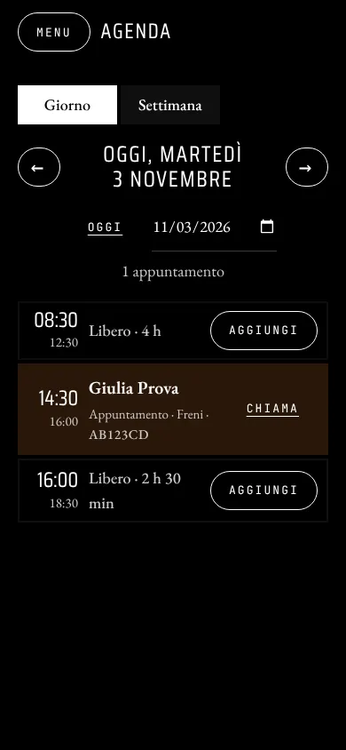
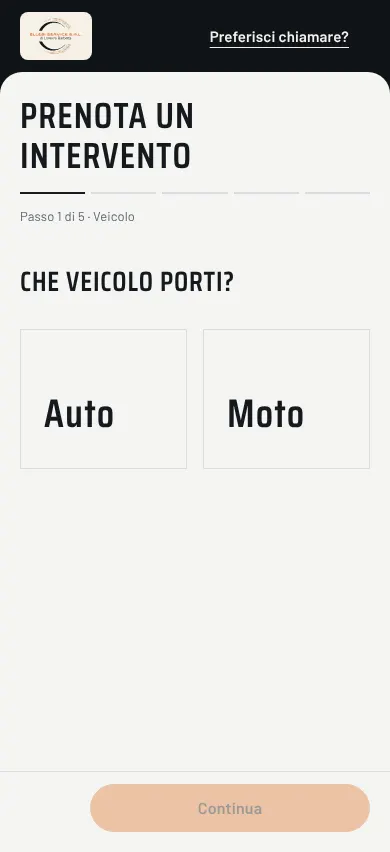
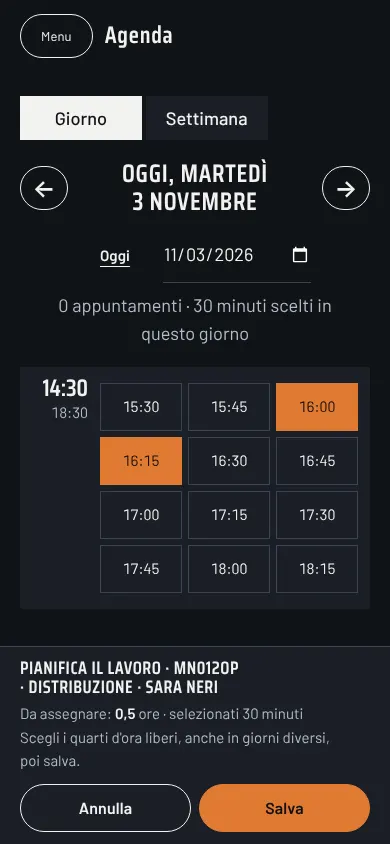

# Ellebi Service

**A booking and workshop management web app for a car and motorcycle repair shop in Piedmont — built to take the organising off the mechanic's hands, so he can spend his day being a mechanic.**

[](https://github.com/Marco17Cherubini/Ellebi-Service/actions/workflows/ci.yml)


> The user interface is in Italian: the app is built for an Italian workshop (Ellebi Service SRL) and its customers.
> All screenshots in this README show **synthetic demo data** created with `npm run seed`.

---

## The story

### Context

Ellebi Service is a car and motorcycle workshop in **San Giuliano Vecchio**, a village in the province of Alessandria, Piedmont. Like [Lev Space](https://github.com/Marco17Cherubini/Lev-Space) — the booking system I built for a barbershop — this project starts from one goal: remove the organisational work from the owner's day and leave him only the work that is really his, the mechanic's.

### The problem

The owner told me that his biggest issue was not the repairs: it was the phone. **Constant calls interrupted his work**, so he could never stay focused on a job for long, and every interruption meant putting down the tools, checking the agenda in his head and finding a slot.

On top of that, a workshop calendar is not a list of identical slots:

- jobs have **very different durations** — an oil change takes an hour, a full service two, a brake job an hour and a half;
- some jobs cannot be booked as an appointment at all: the customer **drops the vehicle off**, explains the problem, and the work is planned later, in pieces, around the other appointments;
- the workshop can only keep **a limited number of vehicles** at the same time;
- seasonal work (tyre changes) is only offered in some months, and the price list changes over time.

### How we solved it

The app is a revisited version of the Lev Space booking system, customised around the workshop's requests:

- **customers and guests book by service**: the calendar only offers start times where the whole job fits, within a shift and without overlapping other work;
- **drop-offs become deposits**: booking a drop-off service reserves a 30-minute reception slot and opens a card in the _Lavori Straordinari_ page, with the customer's notes, the mechanic's notes and the estimated hours;
- **the mechanic plans the work on the weekly calendar**, in 15-minute blocks, next to the regular appointments; when the job is done the customer gets a pick-up email;
- **the rules live on the server**: durations come from the price list, opening hours depend on the role, capacity is checked before accepting a drop-off, and every multi-step change is a single transaction.


| Booking on a phone: only start times where the whole job fits                                                       | Workshop day view on a phone, including free gaps                                                                  |
| ------------------------------------------------------------------------------------------------------------------- | ------------------------------------------------------------------------------------------------------------------ |
|  |  |

### Results — and what they taught us

The software works: bookings, drop-offs, planning, reports and the admin tools are in place and covered by **118 automated tests** plus browser checks on desktop and mobile.

Adoption is the hard part. Lev Space's customers are mostly **20–30 years old** and booked online from day one. Ellebi Service's customers are on average **45–60 years old**: many of them would rather pick up the phone than open a web app, so the calls the system was meant to remove did not go away on their own.

This is the honest state of the project: a good booking system is not enough if the people who should use it prefer another channel. The next step is to meet them on that channel.

### Next step: an AI phone receptionist

Instead of asking every customer to change habit, let the phone answer itself — and let the booking system stay the single source of truth behind it.

**How it would work**

- the workshop keeps its number and **forwards calls** (always, or when busy / not answered) to a voice-AI number;
- an Italian-speaking voice agent (speech-to-text → LLM → text-to-speech, on a managed platform such as [Retell AI](https://www.retellai.com/pricing) or [Vapi](https://vapi.ai/pricing)) greets the customer, understands the service and the vehicle, and **reads the real availability** from this app's API (`/api/slots/:date/:serviceId`, already duration-aware);
- it **books the appointment or the drop-off through the same rules** as the web app (durations, opening hours, overlaps, deposit capacity), so the calendar never diverges;
- anything it cannot handle — quotes, complaints, an unclear request — becomes a **message for the mechanic** (call summary in the admin panel or by SMS/WhatsApp), to be called back when he has a minute;
- the web app **stays active**: younger customers keep booking online, and the admin calendar remains the organiser of the workshop's work.

**What it costs**

| Item                                  | Assumption                                                                       | Monthly estimate    |
| ------------------------------------- | -------------------------------------------------------------------------------- | ------------------- |
| Voice AI (STT + LLM + TTS + platform) | ~250 minutes/month (about 8 short calls per working day), ~€0.07–0.09/min all-in | ~€18–23             |
| Phone number for the forwarded calls  | Italian virtual number from a VoIP provider                                      | ~€1–5               |
| **Total**                             |                                                                                  | **~€20–28 / month** |

About **€25 a month**, easily sustainable for the SRL, against hours of interrupted work. The cost grows with the number of minutes, so the forwarding rule (all calls, or only the unanswered ones) is also the cost control. Prices are estimates and must be checked on the providers' pricing pages at setup time.

**Integration work on this repository** (not built yet): a server-to-server API key for the voice agent, an endpoint to create bookings on behalf of a caller (name, phone, plate), and a "calls to return" list in the admin panel.

Development is ongoing, driven by the workshop's feedback: the goal is not to ship a perfect product on the first try, but to keep acting and improving until the phone stops interrupting the work.

---

## Built with Claude

<!-- TODO (author): describe how Claude / Claude Code was used in this project —
     analysis, refactoring plan, tests, security fixes, documentation, what you reviewed and decided yourself. -->

_Section to be written by the author._

---

## What makes it different

### Duration-aware calendar

Each service in the price list has its own duration. The server computes availability as time intervals: a start time is offered only if `[start, start + duration)` fits entirely inside a morning or afternoon shift and does not intersect another booking, a planned work block or a holiday. The duration always comes from the price list, never from the browser.

### Drop-offs and the deposit board

Services marked as _consegna_ (drop-off) create a 30-minute reception appointment **and** a deposit card. Deposits move through _in attesa_ → _in corso_ → _completato_, with customer notes, internal notes and remaining hours. A configurable limit stops new drop-offs when the workshop is full.


### Work planned on the same calendar

From a deposit card the mechanic opens the weekly calendar and assigns the estimated hours in 15-minute blocks. Each block is validated like an appointment, and the whole plan is saved or rejected as one transaction. Moving the reception appointment keeps its link with the deposit; cancelling it removes the deposit and its blocks.


### Price list with seasonal services

The admin edits services, vehicle type (car or motorcycle), duration and internal price from the _Listino_ page. Seasonal services (for example winter tyre changes, 15 November – 15 April) appear to customers only inside their window.


### Customers

The admin client list shows registered customers and guests. Customers can be marked **VIP** (extended hours: early morning and evening) or **suspended** (no login, active sessions stop working). Every booking stores plate and model; for vehicles saved on a customer account the list shows the number of bookings per plate and the plate's full history.

### Reports

Weekly and monthly charts of appointments per day, counted in the workshop's time zone (work blocks on deposits are not counted as bookings).


Also included: guest booking without an account, email confirmations and password reset via Resend, light/dark theme, drag & drop of appointments and drag-select of holidays in the admin calendar, automatic retention of expired personal data in production.

---

## November 2026: redesign and fixes

**Business problem.** The workshop's day is interrupted by phone calls; the app exists to move bookings online, but many customers still prefer the phone. **Adoption** is the real obstacle, so this round focused on making booking obvious and quick — without assuming anyone is unable to use it — and on fixing what could make the workshop distrust the data.

**What changed**

- **One booking flow** for guests and registered customers (`/prenota`, old URLs still work): vehicle → service → day and time → vehicle and contacts → summary → confirmation. Times come only from the server's per-service endpoint, so the page can no longer offer a slot that crosses the lunch break and gets rejected at the end. Drop-offs are explained plainly: a 30-minute reception, no promised return date.
- **Client area** with upcoming bookings (move or cancel while allowed), saved vehicles (the API existed but was hidden) and a one-click "remember this vehicle".
- **Workshop day view**: every booking of the day in time order — including VIP and workshop bookings outside the weekly grid, which were previously invisible — with free gaps, holidays and a call button. The weekly grid now warns when bookings fall outside it.
- **New identity**, built on the Bugatti `DESIGN.md` from [awesome-design-md](https://github.com/VoltAgent/awesome-design-md): pure black, uppercase letter-spaced Saira Condensed titles at weight 400, EB Garamond body, JetBrains Mono for buttons, labels and times, hairlines instead of boxes or shadows, pill buttons. The one accent is the copper of the workshop's own logo, kept for the main action. The original logo file is shown untouched on a plate; its circle and tread arcs were traced from it into an SVG that serves as the stage behind the car and a faint backdrop on forms. The home page is a menu built from a **stylised 3D car** that opens into an exploded view: each part (Meccanica, Gomme e freni, Consegna, Orari, Contatti) opens a panel with the real services from the price list, today's free quarter-hours, or the contacts, and a service links straight into the booking flow. It is procedural and generic (not a real vehicle) and entirely optional: a still image rendered from the same model, with the labels already in place, is always shown first, and booking never depends on 3D.
- **Security and data fixes** (all with tests): sessions closed by a password reset, single-use reset links, admin tokens tied to an existing account, no internal notes or tokens in customer responses, no internal price in the public price list, banned customers cannot book as guests, guests can claim their email through a link, past or in-progress bookings cannot be cancelled by the customer, seasonal services checked on the booked date, drop-offs identified only by `tipo_servizio` (with migration), guest phone numbers kept, past work blocks kept as history.

**Measured (lab, empty cache, Chromium headless with software GPU, not field data)**

|                                                  | Before (`85d017c`) | After                                                                        |
| ------------------------------------------------ | ------------------ | ---------------------------------------------------------------------------- |
| Home, transferred (mobile, 3D excluded)          | 127 KB             | 271 KB (fonts 84 KB, logo 51 KB, car image 42 KB, ring SVG inline)           |
| Home LCP, mobile (4× CPU, ~1.6 Mbps, 150 ms RTT) | 1.29 s             | 1.76 s                                                                       |
| Home CLS                                         | 0.041              | 0                                                                            |
| Booking page, transferred / LCP mobile           | 169 KB / 1.40 s    | 211 KB / 1.20 s                                                              |
| 3D module (Three.js included), gzip              | —                  | 140 KB, ready in ~0.5 s (desktop)                                            |
| 3D scene                                         | —                  | 19,474 triangles, 28 draw calls, pixel ratio ≤ 1.5, no rendering while still |

Frame rate could not be measured meaningfully (software GPU, headless browser) and **no physical phone was tested**; see the limitations below.

## November 2026 (second round): fixes and "L'insegna"

**Verified defects and fixes** (tests in `test/` and browser e2e in `test/e2e/`, `npm run test:e2e`):

- **Extra work planning on phones**: the page opened in the day view, which had no planning tools, so no blocks were ever saved. The day view now lists free quarter-hours as buttons (touch, mouse, keyboard); the weekly grid stays for wide screens. A failed hours save no longer opens the planning, and deposit cards show the work actually in the agenda, separate from the "in corso" state.
- **Admin pages**: all admin APIs already answered 401/403 to visitors and customers (verified for every route); now the admin pages themselves, including the `.html` files, are only sent to an admin session, and the client area to a customer session.
- **3D controls**: below 760 px the 3D canvas covered the car's part labels (the home menu). Labels now sit above the canvas.
- **Durations**: the public site no longer presents the internal 15-minute grid as a duration; appointments show the price-list duration range, drop-offs show a 30-minute reception that is not the repair time, and undefined durations read "da concordare".

**New identity, direction B "L'insegna"** ([DESIGN.md](DESIGN.md)): the original logo, traced to vector, is a round lit sign behind the car; a dark stage presents, a light sheet is used for booking, sign-in and the client area; Ellebi orange is for actions, blue for structure and light; Saira Condensed titles and Barlow text, self-hosted. The car is a procedural mid-engine GT with Ferrari-like proportions, generic and unbranded (not a real model); the stills are rendered from it (`npm run render:stills`).

| Home on a phone                                                                                                          | Booking                                                              | Planning on a phone                                                                                                 |
| ------------------------------------------------------------------------------------------------------------------------ | -------------------------------------------------------------------- | ------------------------------------------------------------------------------------------------------------------- |
|  |  |  |

Lab measurements (Chromium headless, software GPU, 4× CPU, ~1.6 Mbps): home 271 KB → 206 KB, LCP 1.80 s → 1.63 s, CLS 0; booking 211 KB → 158 KB; optional 3D 141 KB gzip, 19,498 triangles, 30 draw calls. Not verified on a physical phone.

### November 2026, third round: back to the original structure

The owner's feedback after the release: the public home had become a showcase (3D menu, price list, links that changed with the session, including "Agenda officina" for an admin session) and on phones some labels ran past the right edge, so the page could be zoomed out.

- **Entry page as in the original app**: the round sign with the logo and the car (still image), then only **Accedi**, **Registrati** and **Prenota come ospite**. The same page for every visitor, with or without a session; no link to the admin area on any public page. The admin reaches the agenda only by signing in (and `/admin` stays protected on the server).
- **The interactive 3D is no longer published**: `client-src/garage3d.js` is kept only to render the car still (`npm run build:3d && npm run render:stills`, bundle in the ignored `client-src/build/`).
- **Mobile first, checked page by page** at 360, 390 and 430 px in the three roles: nothing wider than the screen. Fixes: the home price list (gone with the showcase), the admin price list (a card per service instead of a table that scrolled sideways), the client list (name and controls on two lines), the day strip of the booking flow (first day no longer flush with the edge), the theme switch (no longer over the footer text).
- Tests: `test/entry.test.js` (entry links, no admin links on public pages) and `test/e2e/mobile-layout.e2e.js` (no page wider than the screen, admin session on the home).

## Under the hood

### Tech stack

| Layer    | Choice                                         | Why                                                                                                                       |
| -------- | ---------------------------------------------- | ------------------------------------------------------------------------------------------------------------------------- |
| Server   | Node.js + Express 4                            | Small, well known, easy to run as a single instance                                                                       |
| Database | SQLite via [sql.js](https://sql.js.org) (WASM) | One file on a volume, no native build; atomic writes and transactions for multi-row work                                  |
| Auth     | JWT in an `httpOnly`, `SameSite=Lax` cookie    | No token reachable from JavaScript; argon2id hashes (older bcrypt hashes upgraded at login)                               |
| Frontend | HTML, CSS and vanilla JavaScript               | No build step for pages; design tokens and layered CSS; self-hosted Saira Condensed, EB Garamond and JetBrains Mono (OFL) |
| 3D       | Three.js, bundled with esbuild (not published) | `client-src/garage3d.js` → `client-src/build/`, used only to render the car still of the entry page                       |
| Email    | Resend                                         | Booking confirmations, pick-up notices, password reset                                                                    |
| Charts   | Chart.js, served from the npm package          | Admin reports, version pinned in the lockfile                                                                             |
| Tests    | `node:test` (built into Node)                  | No test framework to install                                                                                              |

### Architecture

```
frontend/ (static pages, vanilla JS)          server/
  js/utils.js     apiRequest, escapeHTML,       server.js         startup: config checks, DB, retention, listen
                  sidebar, keyboard helper      app.js            security headers, JSON parser, static files, routes
  js/<page>.js    one script per page           routes/           auth · bookings · admin · catalog · deposits · pages
  js/booking-flow.js  guest + customer booking
  styles/         tokens → base → layout        bookingService    availability, bookings, drop-offs, moves, work blocks
                  → components → pages          depositService    capacity, states, deposit board
                                                catalogService · holidayService · vehicleService · reportService
                                                authService · emailService · retentionService · dates
           fetch JSON  ───────────────────▶     database.js       sql.js wrapper, atomic save, withTransaction
```

Routes only translate HTTP; the workshop rules live in the services, which throw `HttpError`s handled in one place (unexpected errors become a generic 500).

### Quality and security

- **136 automated tests** against the real server and a temporary SQLite file: availability and durations, opening hours by role, overlaps and concurrent requests, customer/guest/admin bookings, drop-offs and deposits, moves and cancellations, holidays, price list, auth and bans, rate limiting, error handling, reports, persistence, migrations, backup and demo seed.
- **Content Security Policy** with scripts only from the app and no inline handlers; every user-provided value is escaped before entering HTML, in pages and emails; JSON-only API; rate limiting on login and guest bookings.
- **Data integrity**: the database file is written atomically (temporary file + rename) and multi-row operations run in transactions.
- **Accessibility**: the booking flow works with the keyboard only, fields have visible labels and errors tied to them (`aria-describedby`), focus moves to each step's heading, touch targets are at least 44 px, and motion respects `prefers-reduced-motion`.
- ESLint + Prettier, and a GitHub Actions workflow running lint, formatting check and tests on Node 22 and 24.

---

## Getting started

Requirements: **Node.js 22 or newer**.

```bash
git clone https://github.com/Marco17Cherubini/Ellebi-Service.git
cd Ellebi-Service
npm install
cp .env.example .env        # on Windows: copy .env.example .env
```

Open `.env` and set at least:

- `JWT_SECRET` — a long random string (`node -e "console.log(require('crypto').randomBytes(64).toString('hex'))"`);
- `ADMIN_EMAIL` and `ADMIN_PASSWORD` — the admin account created on first start.

Then load the demo data and start the app:

```bash
npm run seed    # demo customers, two months of history, upcoming bookings, deposits
npm start       # http://localhost:3000
```

Demo logins: the admin from your `.env`, or any demo customer such as `giulia.bianchi@demo.example.com` / `Demo12345!`.

### Useful scripts

| Command                                 | What it does                                                                |
| --------------------------------------- | --------------------------------------------------------------------------- |
| `npm run dev`                           | Start with auto-reload (nodemon)                                            |
| `npm test`                              | Run the test suite                                                          |
| `npm run lint` / `npm run format:check` | ESLint and Prettier checks                                                  |
| `npm run seed`                          | Fill an **empty** database with demo data                                   |
| `npm run backup`                        | Copy the database to `BACKUP_DIR` (keeps the last 4)                        |
| `npm run start:prod`                    | Start in production with PM2                                                |
| `npm run build:3d`                      | Bundle the 3D model into `client-src/build/` (needed by `render:stills`)    |
| `npm run render:stills`                 | Render the car still of the entry page from the 3D model (needs Playwright) |
| `npm run test:e2e`                      | Browser end-to-end tests (needs Playwright with Chromium; not run in CI)    |

### Configuration

| Variable                                        | Required    | Default                    | Purpose                                                        |
| ----------------------------------------------- | ----------- | -------------------------- | -------------------------------------------------------------- |
| `JWT_SECRET`                                    | yes         | —                          | Signs session tokens; the server refuses to start without it   |
| `ADMIN_EMAIL`, `ADMIN_PASSWORD`                 | first start | —                          | Admin account created when none exists                         |
| `PORT`                                          | no          | `3000`                     | HTTP port                                                      |
| `NODE_ENV`                                      | no          | `development`              | `production` enables secure cookies, proxy trust and retention |
| `BASE_URL`                                      | no          | `http://localhost:3000`    | Public URL used in password-reset emails                       |
| `TZ`                                            | no          | `Europe/Rome`              | Time zone of slots, "today" and reports                        |
| `DATABASE_PATH`                                 | no          | `database/database.sqlite` | SQLite file (e.g. `/data/database.sqlite` on a Railway volume) |
| `BACKUP_DIR`                                    | no          | `backups/`                 | Destination of `npm run backup`                                |
| `RETENTION_ENABLED`                             | no          | on in production only      | Automatic deletion of expired personal data                    |
| `RESEND_API_KEY`, `EMAIL_FROM`                  | no          | —                          | Email sending; without a key emails are skipped                |
| `RATE_LIMIT_AUTH_MAX`, `RATE_LIMIT_GUEST_MAX`   | no          | `10`, `5`                  | Requests per IP every 15 minutes                               |
| `STUDIO_NAME`, `STUDIO_PHONE`, `STUDIO_ADDRESS` | no          | see `config/config.js`     | Workshop details shown in emails                               |

Opening days, shifts and the 15-minute grid are set in `config/config.js`; the deposit limit is changed by the admin from the _Lavori Straordinari_ page.

### Deployment

The app runs as a single instance (for example on [Railway](https://railway.app) with PM2 or `npm start`): mount a volume, point `DATABASE_PATH` to it, set `NODE_ENV=production` and the variables above. sql.js keeps the database in memory and saves it to one file, so the app must run as **one process** (no cluster mode). In production the retention job deletes expired bookings, deposits, vehicles and inactive accounts every 24 hours (see `server/retentionService.js`).

---

## Development

Before pushing, run `npm run lint`, `npm run format:check` and `npm test` — the same checks run in CI.

- **Server**: routes in `server/routes/` only translate HTTP; the rules live in the services, which throw `HttpError(status, message)`. Multi-row writes go through `withTransaction()`; calendar dates go through `server/dates.js` (never `toISOString()` for a day).
- **Frontend**: one script per page in `frontend/js/`, shared helpers in `utils.js` (`apiRequest`, `escapeHTML`, `setupSidebar`, `makeKeyboardActivatable`). No inline scripts or `onclick` (the CSP blocks them), and every user-provided value goes through `escapeHTML()`.
- **CSS**: `tokens → base → layout → components → pages`, imported by `styles.css`; page-specific files in `styles/pages/`.
- User-facing text and code comments are in Italian; commits follow Conventional Commits. The refactoring log and decisions are in [docs/refactoring-plan.md](docs/refactoring-plan.md); a user guide in Italian is in [docs/user-guide.it.md](docs/user-guide.it.md).

## Known limitations

- **Single instance**: sql.js keeps the database in memory and saves it to one file, so the app must run as one process (PM2 is pinned to one instance).
- **No physical device tested**: mobile checks are emulated (Chromium at 320–1440 px); frame rate, battery and heat on real phones are unverified.
- **No photographs**: the project has no pictures of the workshop and none were invented; the Bugatti system leans on photography, here the 3D car and the logo motif take that place. The Taste inspector's "at least four pictures" floor is therefore not met.
- **Three typefaces and a light theme**: the three families come from the Bugatti `DESIGN.md` (which has no light mode; the optional light theme was kept because the original app had a theme toggle).
- **3D**: no longer on the site; the car on the entry page is a still rendered from a generic stylised model, not a reconstruction of a real one.
- **VIP extended hours** (08:00 and evening starts up to 23:15) are inherited from the barbershop version and still to be confirmed with the workshop; they are now visible in the day view.
- **Logout** clears the cookie but does not revoke the token on the server (a password reset does); sessions last 7 days.
- **Guest emails are not verified**: a guest booking made with a registered customer's email appears in that account (decision D-9).
- **Drop-off capacity** is taken when the drop-off is booked, not when the vehicle arrives (existing rule).
- **Reminders**: the `notifications` table is unused; no reminder is sent.
- **Admin weekly grid** is drag & drop (mouse and touch); the day view is the keyboard-friendly alternative.
- Browser checks run locally with Playwright, not in CI.

## Project structure

```
config/        opening hours, slot grid and defaults
docs/          refactoring plan, user guide, portfolio checklist, screenshots
client-src/    3D model used to render the car still (`npm run build:3d && npm run render:stills`)
frontend/      HTML pages, js/, styles/ (tokens, base, layout, components, pages), fonts/, images/
server/        app, routes, services, database, seed and backup scripts
test/          node:test suites and helpers
```

## Author

Designed and built by **Marco Cherubini** — [github.com/Marco17Cherubini](https://github.com/Marco17Cherubini).

## License

[MIT](LICENSE) © Marco Cherubini
