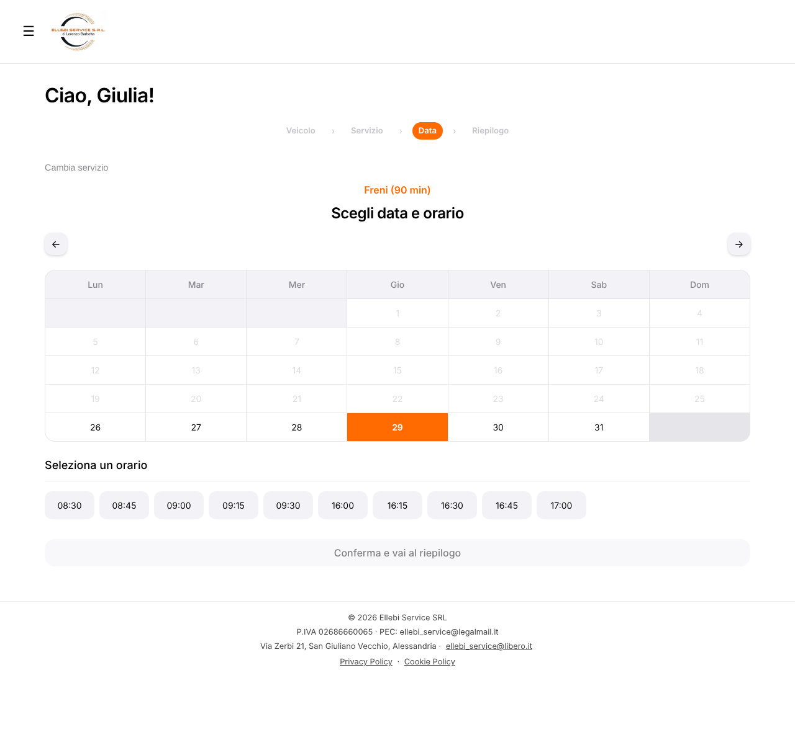
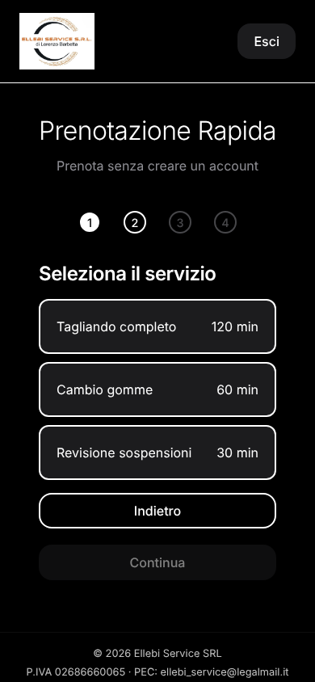
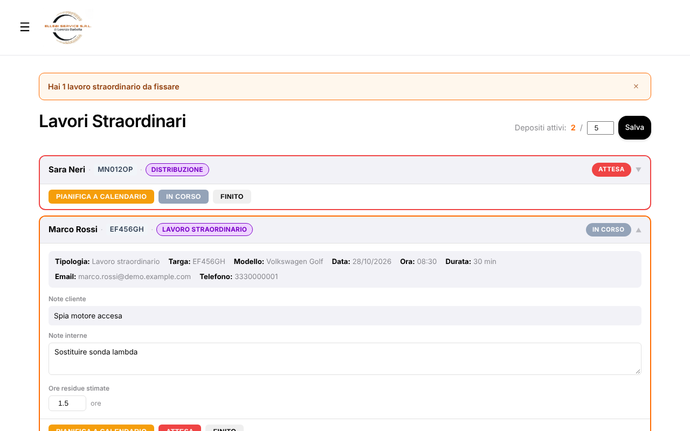
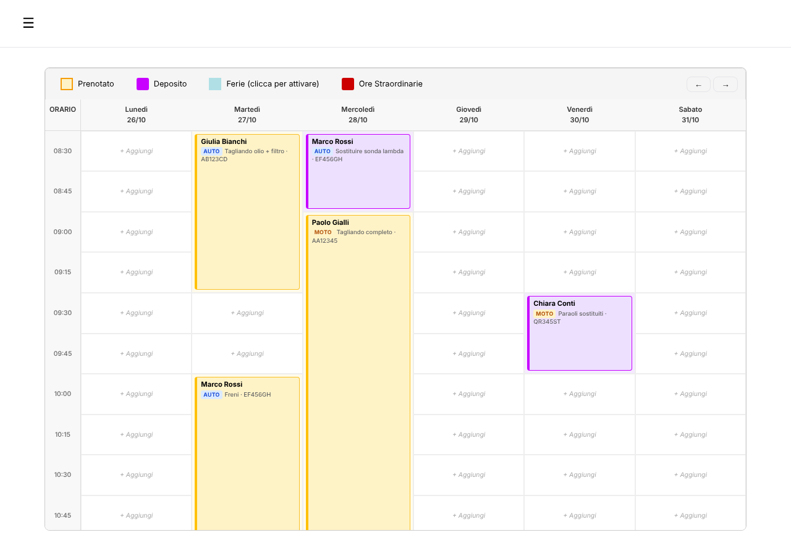
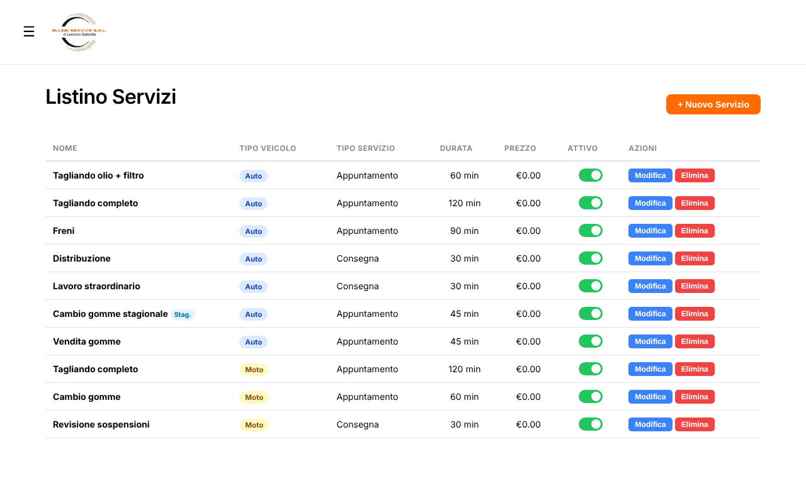
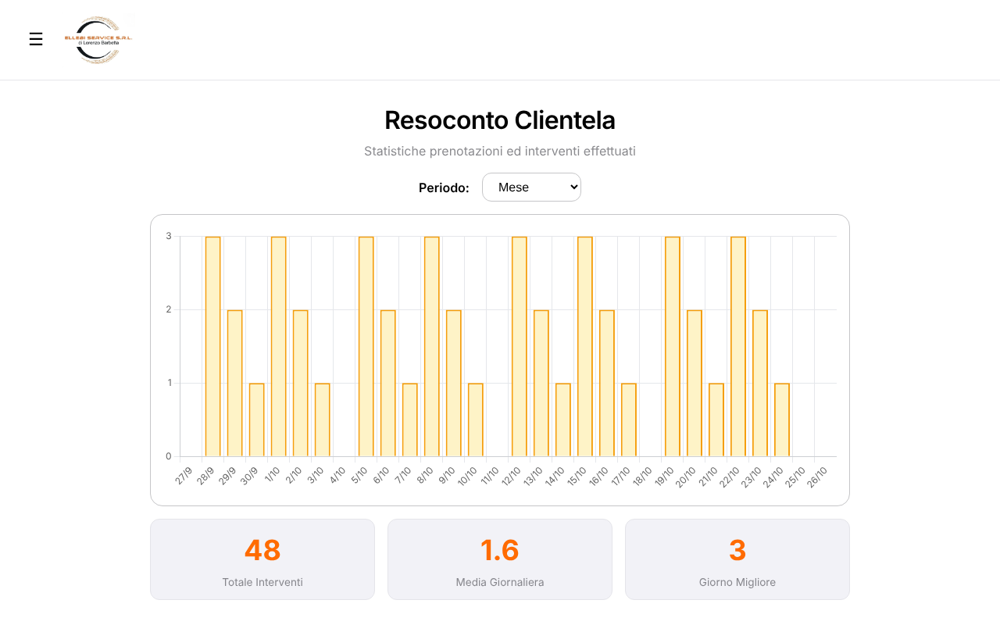

# Ellebi Service

**A booking and workshop management web app for a car and motorcycle repair shop in Piedmont — built to take the organising off the mechanic's hands, so he can spend his day being a mechanic.**

[](https://github.com/Marco17Cherubini/Ellebi-Service/actions/workflows/ci.yml)


> The user interface is in Italian: the app is built for an Italian workshop (Ellebi Service SRL) and its customers.
> All screenshots in this README show **synthetic demo data** created with `npm run seed`.

---

## The story

### Context

Ellebi Service is a car and motorcycle workshop in **San Giuliano Vecchio**, a village in the province of Alessandria, Piedmont. Like [Lev Space](https://github.com/Marco17Cherubini/Lev-Space) — the booking system I built for a barbershop — this project starts from one goal: remove the organisational work from the owner's day and leave him only the work that is really his, the mechanic's.

### The problem

The owner told me that his biggest issue was not the repairs: it was the phone. **Constant calls interrupted his work**, so he could never stay focused on a job for long, and every interruption meant putting down the tools, checking the agenda in his head and finding a slot.

On top of that, a workshop calendar is not a list of identical slots:

- jobs have **very different durations** — an oil change takes an hour, a full service two, a brake job an hour and a half;
- some jobs cannot be booked as an appointment at all: the customer **drops the vehicle off**, explains the problem, and the work is planned later, in pieces, around the other appointments;
- the workshop can only keep **a limited number of vehicles** at the same time;
- seasonal work (tyre changes) is only offered in some months, and the price list changes over time.

### How we solved it

The app is a revisited version of the Lev Space booking system, customised around the workshop's requests:

- **customers and guests book by service**: the calendar only offers start times where the whole job fits, within a shift and without overlapping other work;
- **drop-offs become deposits**: booking a drop-off service reserves a 30-minute reception slot and opens a card in the _Lavori Straordinari_ page, with the customer's notes, the mechanic's notes and the estimated hours;
- **the mechanic plans the work on the weekly calendar**, in 15-minute blocks, next to the regular appointments; when the job is done the customer gets a pick-up email;
- **the rules live on the server**: durations come from the price list, opening hours depend on the role, capacity is checked before accepting a drop-off, and every multi-step change is a single transaction.

| Customer booking: only start times where a 90-minute job fits                                                         | Guest booking on mobile (dark theme)                                                      |
| --------------------------------------------------------------------------------------------------------------------- | ----------------------------------------------------------------------------------------- |
|  |  |

### Results — and what they taught us

The software works: bookings, drop-offs, planning, reports and the admin tools are in place and covered by **98 automated tests** plus browser checks on desktop and mobile.

Adoption is the hard part. Lev Space's customers are mostly **20–30 years old** and booked online from day one. Ellebi Service's customers are on average **45–60 years old**: many of them would rather pick up the phone than open a web app, so the calls the system was meant to remove did not go away on their own.

This is the honest state of the project: a good booking system is not enough if the people who should use it prefer another channel. The next step is to meet them on that channel.

### Next step: an AI phone receptionist

Instead of asking every customer to change habit, let the phone answer itself — and let the booking system stay the single source of truth behind it.

**How it would work**

- the workshop keeps its number and **forwards calls** (always, or when busy / not answered) to a voice-AI number;
- an Italian-speaking voice agent (speech-to-text → LLM → text-to-speech, on a managed platform such as [Retell AI](https://www.retellai.com/pricing) or [Vapi](https://vapi.ai/pricing)) greets the customer, understands the service and the vehicle, and **reads the real availability** from this app's API (`/api/slots/:date/:serviceId`, already duration-aware);
- it **books the appointment or the drop-off through the same rules** as the web app (durations, opening hours, overlaps, deposit capacity), so the calendar never diverges;
- anything it cannot handle — quotes, complaints, an unclear request — becomes a **message for the mechanic** (call summary in the admin panel or by SMS/WhatsApp), to be called back when he has a minute;
- the web app **stays active**: younger customers keep booking online, and the admin calendar remains the organiser of the workshop's work.

**What it costs**

| Item                                  | Assumption                                                                       | Monthly estimate    |
| ------------------------------------- | -------------------------------------------------------------------------------- | ------------------- |
| Voice AI (STT + LLM + TTS + platform) | ~250 minutes/month (about 8 short calls per working day), ~€0.07–0.09/min all-in | ~€18–23             |
| Phone number for the forwarded calls  | Italian virtual number from a VoIP provider                                      | ~€1–5               |
| **Total**                             |                                                                                  | **~€20–28 / month** |

About **€25 a month**, easily sustainable for the SRL, against hours of interrupted work. The cost grows with the number of minutes, so the forwarding rule (all calls, or only the unanswered ones) is also the cost control. Prices are estimates and must be checked on the providers' pricing pages at setup time.

**Integration work on this repository** (not built yet): a server-to-server API key for the voice agent, an endpoint to create bookings on behalf of a caller (name, phone, plate), and a "calls to return" list in the admin panel.

Development is ongoing, driven by the workshop's feedback: the goal is not to ship a perfect product on the first try, but to keep acting and improving until the phone stops interrupting the work.

---

## Built with Claude

<!-- TODO (author): describe how Claude / Claude Code was used in this project —
     analysis, refactoring plan, tests, security fixes, documentation, what you reviewed and decided yourself. -->

_Section to be written by the author._

---

## What makes it different

### Duration-aware calendar

Each service in the price list has its own duration. The server computes availability as time intervals: a start time is offered only if `[start, start + duration)` fits entirely inside a morning or afternoon shift and does not intersect another booking, a planned work block or a holiday. The duration always comes from the price list, never from the browser.

### Drop-offs and the deposit board

Services marked as _consegna_ (drop-off) create a 30-minute reception appointment **and** a deposit card. Deposits move through _in attesa_ → _in corso_ → _completato_, with customer notes, internal notes and remaining hours. A configurable limit stops new drop-offs when the workshop is full.



### Work planned on the same calendar

From a deposit card the mechanic opens the weekly calendar and assigns the estimated hours in 15-minute blocks. Each block is validated like an appointment, and the whole plan is saved or rejected as one transaction. Moving the reception appointment keeps its link with the deposit; cancelling it removes the deposit and its blocks.



### Price list with seasonal services

The admin edits services, vehicle type (car or motorcycle), duration and internal price from the _Listino_ page. Seasonal services (for example winter tyre changes, 15 November – 15 April) appear to customers only inside their window.



### Customers

The admin client list shows registered customers and guests. Customers can be marked **VIP** (extended hours: early morning and evening) or **suspended** (no login, active sessions stop working). Every booking stores plate and model; for vehicles saved on a customer account the list shows the number of bookings per plate and the plate's full history.

### Reports

Weekly and monthly charts of appointments per day, counted in the workshop's time zone (work blocks on deposits are not counted as bookings).



Also included: guest booking without an account, email confirmations and password reset via Resend, light/dark theme, drag & drop of appointments and drag-select of holidays in the admin calendar, automatic retention of expired personal data in production.

---

## Under the hood

### Tech stack

| Layer    | Choice                                         | Why                                                                                         |
| -------- | ---------------------------------------------- | ------------------------------------------------------------------------------------------- |
| Server   | Node.js + Express 4                            | Small, well known, easy to run as a single instance                                         |
| Database | SQLite via [sql.js](https://sql.js.org) (WASM) | One file on a volume, no native build; atomic writes and transactions for multi-row work    |
| Auth     | JWT in an `httpOnly`, `SameSite=Lax` cookie    | No token reachable from JavaScript; argon2id hashes (older bcrypt hashes upgraded at login) |
| Frontend | HTML, CSS and vanilla JavaScript               | No build step; design tokens and layered CSS                                                |
| Email    | Resend                                         | Booking confirmations, pick-up notices, password reset                                      |
| Charts   | Chart.js, served from the npm package          | Admin reports, version pinned in the lockfile                                               |
| Tests    | `node:test` (built into Node)                  | No test framework to install                                                                |

### Architecture

```
frontend/ (static pages, vanilla JS)          server/
  js/utils.js     apiRequest, escapeHTML,       server.js         startup: config checks, DB, retention, listen
                  sidebar, keyboard helper      app.js            security headers, JSON parser, static files, routes
  js/<page>.js    one script per page           routes/           auth · bookings · admin · catalog · deposits · pages
  styles/         tokens → base → layout        bookingService    availability, bookings, drop-offs, moves, work blocks
                  → components → pages          depositService    capacity, states, deposit board
                                                catalogService · holidayService · vehicleService · reportService
                                                authService · emailService · retentionService · dates
           fetch JSON  ───────────────────▶     database.js       sql.js wrapper, atomic save, withTransaction
```

Routes only translate HTTP; the workshop rules live in the services, which throw `HttpError`s handled in one place (unexpected errors become a generic 500).

### Quality and security

- **98 automated tests** against the real server and a temporary SQLite file: availability and durations, opening hours by role, overlaps and concurrent requests, customer/guest/admin bookings, drop-offs and deposits, moves and cancellations, holidays, price list, auth and bans, rate limiting, error handling, reports, persistence, migrations, backup and demo seed.
- **Content Security Policy** with scripts only from the app and no inline handlers; every user-provided value is escaped before entering HTML, in pages and emails; JSON-only API; rate limiting on login and guest bookings.
- **Data integrity**: the database file is written atomically (temporary file + rename) and multi-row operations run in transactions.
- **Accessibility**: the booking wizards work with the keyboard only (Tab, Enter, Space) with a visible focus.
- ESLint + Prettier, and a GitHub Actions workflow running lint, formatting check and tests on Node 22 and 24.

---

## Getting started

Requirements: **Node.js 22 or newer**.

```bash
git clone https://github.com/Marco17Cherubini/Ellebi-Service.git
cd Ellebi-Service
npm install
cp .env.example .env        # on Windows: copy .env.example .env
```

Open `.env` and set at least:

- `JWT_SECRET` — a long random string (`node -e "console.log(require('crypto').randomBytes(64).toString('hex'))"`);
- `ADMIN_EMAIL` and `ADMIN_PASSWORD` — the admin account created on first start.

Then load the demo data and start the app:

```bash
npm run seed    # demo customers, two months of history, upcoming bookings, deposits
npm start       # http://localhost:3000
```

Demo logins: the admin from your `.env`, or any demo customer such as `giulia.bianchi@demo.example.com` / `Demo12345!`.

### Useful scripts

| Command                                 | What it does                                         |
| --------------------------------------- | ---------------------------------------------------- |
| `npm run dev`                           | Start with auto-reload (nodemon)                     |
| `npm test`                              | Run the test suite                                   |
| `npm run lint` / `npm run format:check` | ESLint and Prettier checks                           |
| `npm run seed`                          | Fill an **empty** database with demo data            |
| `npm run backup`                        | Copy the database to `BACKUP_DIR` (keeps the last 4) |
| `npm run start:prod`                    | Start in production with PM2                         |

### Configuration

| Variable                                        | Required    | Default                    | Purpose                                                        |
| ----------------------------------------------- | ----------- | -------------------------- | -------------------------------------------------------------- |
| `JWT_SECRET`                                    | yes         | —                          | Signs session tokens; the server refuses to start without it   |
| `ADMIN_EMAIL`, `ADMIN_PASSWORD`                 | first start | —                          | Admin account created when none exists                         |
| `PORT`                                          | no          | `3000`                     | HTTP port                                                      |
| `NODE_ENV`                                      | no          | `development`              | `production` enables secure cookies, proxy trust and retention |
| `BASE_URL`                                      | no          | `http://localhost:3000`    | Public URL used in password-reset emails                       |
| `TZ`                                            | no          | `Europe/Rome`              | Time zone of slots, "today" and reports                        |
| `DATABASE_PATH`                                 | no          | `database/database.sqlite` | SQLite file (e.g. `/data/database.sqlite` on a Railway volume) |
| `BACKUP_DIR`                                    | no          | `backups/`                 | Destination of `npm run backup`                                |
| `RETENTION_ENABLED`                             | no          | on in production only      | Automatic deletion of expired personal data                    |
| `RESEND_API_KEY`, `EMAIL_FROM`                  | no          | —                          | Email sending; without a key emails are skipped                |
| `RATE_LIMIT_AUTH_MAX`, `RATE_LIMIT_GUEST_MAX`   | no          | `10`, `5`                  | Requests per IP every 15 minutes                               |
| `STUDIO_NAME`, `STUDIO_PHONE`, `STUDIO_ADDRESS` | no          | see `config/config.js`     | Workshop details shown in emails                               |

Opening days, shifts and the 15-minute grid are set in `config/config.js`; the deposit limit is changed by the admin from the _Lavori Straordinari_ page.

### Deployment

The app runs as a single instance (for example on [Railway](https://railway.app) with PM2 or `npm start`): mount a volume, point `DATABASE_PATH` to it, set `NODE_ENV=production` and the variables above. sql.js keeps the database in memory and saves it to one file, so the app must run as **one process** (no cluster mode). In production the retention job deletes expired bookings, deposits, vehicles and inactive accounts every 24 hours (see `server/retentionService.js`).

---

## Development

Before pushing, run `npm run lint`, `npm run format:check` and `npm test` — the same checks run in CI.

- **Server**: routes in `server/routes/` only translate HTTP; the rules live in the services, which throw `HttpError(status, message)`. Multi-row writes go through `withTransaction()`; calendar dates go through `server/dates.js` (never `toISOString()` for a day).
- **Frontend**: one script per page in `frontend/js/`, shared helpers in `utils.js` (`apiRequest`, `escapeHTML`, `setupSidebar`, `makeKeyboardActivatable`). No inline scripts or `onclick` (the CSP blocks them), and every user-provided value goes through `escapeHTML()`.
- **CSS**: `tokens → base → layout → components → pages`, imported by `styles.css`; page-specific files in `styles/pages/`.
- User-facing text and code comments are in Italian; commits follow Conventional Commits. The refactoring log and decisions are in [docs/refactoring-plan.md](docs/refactoring-plan.md); a user guide in Italian is in [docs/user-guide.it.md](docs/user-guide.it.md).

## Known limitations

- **Single instance**: sql.js keeps the database in memory and saves it to one file, so the app must run as one process.
- **VIP extended hours** are inherited from the barbershop version (early 08:00 slot, evening starts every 45 minutes up to 23:15) and the admin weekly calendar only shows the regular opening hours, so an evening VIP booking does not appear in the weekly grid. To be reviewed with the workshop.
- **Admin calendar keyboard access** is limited: the booking wizards work with the keyboard, the drag & drop calendar is designed for mouse and touch.
- **Sessions** are not revoked on logout or password change (they expire after 7 days); a password-reset link can be reused within its hour.
- **Guest emails are not verified**: a guest booking made with the email of a registered customer is attached to that customer's account, and a guest cannot later register with the same email.
- **Saved vehicles**: the API can store a customer's vehicles, but the booking page does not offer it yet (its saved-vehicle picker is hidden), so the per-vehicle history in the client list only covers vehicles saved through the API or the demo seed.
- **Notifications**: a `notifications` table exists in the schema for planned service reminders, but no reminder is sent yet.
- **No cancellation deadline**: customers can cancel or move a booking at any time.
- Seasonal services are filtered on today's date, not on the date of the appointment; a service is also treated as a drop-off if its name contains "consegna".
- Browser checks of the main flows are run locally, not in CI.

## Project structure

```
config/        opening hours, slot grid and defaults
docs/          refactoring plan, user guide, portfolio checklist, screenshots
frontend/      HTML pages, js/, styles/ (tokens, base, layout, components, pages)
server/        app, routes, services, database, seed and backup scripts
test/          node:test suites and helpers
```

## Author

Designed and built by **Marco Cherubini** — [github.com/Marco17Cherubini](https://github.com/Marco17Cherubini).

## License

[MIT](LICENSE) © Marco Cherubini
